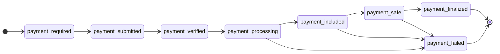

# Building a Cart Mandate

The Cart Mandate is the core payload: order metadata, payment methods, line items, and the merchant JWT.

---

## Full structure

```json
{
  "cart_mandate": {
    "contents": {
      "id": "ORDER-001",
      "user_cart_confirmation_required": true,
      "payment_request": {
        "method_data": [
          {
            "supported_methods": "https://www.x402.org/",
            "data": {
              "x402Version": 2,
              "network": "sepolia",
              "chain_id": 11155111,
              "contract_address": "0x1c7D...",
              "pay_to": "0x99c1...",
              "coin": "USDC"
            }
          },
          {
            "supported_methods": "https://www.x402.org/",
            "data": {
              "x402Version": 2,
              "network": "sepolia",
              "chain_id": 11155111,
              "contract_address": "0x3f3F...",
              "pay_to": "0x99c1...",
              "coin": "USDT"
            }
          }
        ],
        "details": {
          "id": "PAY-REQ-001",
          "display_items": [
            {"label": "Item A", "amount": {"currency": "USD", "value": "10.00"}},
            {"label": "Item B", "amount": {"currency": "USD", "value": "5.00"}}
          ],
          "total": {
            "label": "Total",
            "amount": {"currency": "USD", "value": "15.00"}
          },
          "modifiers": [
            {
              "supported_methods": "https://www.x402.org/",
              "data": {
                "method_data_indexes": [0, 1]
              },
              "additional_display_items": [
                {
                  "label": "Service fee",
                  "amount": {"currency": "USD", "value": "1.00"}
                }
              ],
              "total": {
                "label": "Amount due",
                "amount": {"currency": "USD", "value": "16.00"}
              }
            }
          ]
        }
      },
      "cart_expiry": "2024-03-01T12:00:00Z",
      "merchant_name": "My Store"
    },
    "merchant_authorization": "eyJhbG..."
  },
  "redirect_url": "https://yoursite.com/redirect"
}
```

---

## Field reference

### `contents`

| Field | Type | Required | Description |
|-------|------|----------|-------------|
| `id` | string | Yes | `cart_mandate_id` (ID1) |
| `user_cart_confirmation_required` | bool | Yes | Require shopper confirmation |
| `payment_request` | object | Yes | Payment details |
| `cart_expiry` | string | Yes | RFC 3339 expiry |
| `merchant_name` | string | Yes | Display name |

### `method_data`

Each `method_data` entry describes one accepted payment method. The gateway currently supports the **x402** protocol; the fields below cover `method_data` and its nested `data` object.

| Field | Type | Required | Description |
|-------|------|----------|-------------|
| `supported_methods` | string | Yes | `"https://www.x402.org/"` |
| `data.x402Version` | int | Yes | `2` |
| `data.network` | string | Yes | e.g. `sepolia`, `ethereum` |
| `data.chain_id` | int | Yes | Chain id |
| `data.contract_address` | string | Yes | Token contract |
| `data.pay_to` | string | Yes | Payee |
| `data.coin` | string | Yes | `USDC`, `USDT`, … |

> [!TIP]
> Multiple `method_data` entries enable multi-chain / multi-token checkout.

### `details`

| Field | Type | Required | Description |
|-------|------|----------|-------------|
| `id` | string | Yes | `payment_request_id` (ID2) |
| `display_items` | array | No | Merchandise line items |
| `total` | object | Yes | Merchandise total with `label` + `amount` |
| `shipping_options` | array | No | Shipping options |
| `modifiers` | array | No | Modifiers |

### `modifiers`

A modifier adds charges on top of the merchandise amount. `supported_methods` declares which payment protocol the modifier applies to. It does not describe a chain, contract, or payee.

```json
{
  "supported_methods": "https://www.x402.org/",
  "data": {
    "method_data_indexes": [1]
  },
  "additional_display_items": [
    {
      "label": "Network fee",
      "amount": { "currency": "USD", "value": "1.00" }
    }
  ],
  "total": {
    "label": "Amount due",
    "amount": { "currency": "USD", "value": "11.00" }
  }
}
```

| Field | Type | Required | Description |
|-------|------|----------|-------------|
| `modifiers[].supported_methods` | string | Yes | Payment protocol. Currently `"https://www.x402.org/"`. Comparison trims surrounding whitespace and a trailing `/`, so `https://www.x402.org` is the same method |
| `modifiers[].additional_display_items` | array | Yes | Additional charges; must be non-empty. Multiple entries are shown as one aggregated charge on Checkout |
| `modifiers[].additional_display_items[].label` | string | Yes | Description of the additional charge |
| `modifiers[].additional_display_items[].amount` | object | Yes | Additional charge amount (`currency` + `value`) |
| `modifiers[].total` | object | No | Amount due after additional charges: `label` + `amount` (`currency` + `value`). When present, the value must be greater than 0 |
| `modifiers[].data` | object | No | Payment-method matching data |
| `modifiers[].data.method_data_indexes` | array of int | No | Zero-based indexes into `payment_request.method_data`. When omitted, the modifier applies to every `method_data` entry with the same normalized `supported_methods` |

All currencies in `details.total`, `display_items`, modifier `total.amount`, and `additional_display_items` must be `USD`. `value` is a parseable decimal string. `10.0` and `10.00` compare equal as decimal values.

#### Amount validation

The gateway validates amounts using these rules:

1. If `display_items` is non-empty, `sum(details.display_items[].amount.value) = details.total.amount.value`.
2. When `modifier.total` is present, it must be greater than 0 and:

```text
modifier.total = details.total + sum(additional_display_items)
```

That is, `modifier.total.amount.value` equals `details.total.amount.value` plus the sum of `additional_display_items[].amount.value`.

The effective total for a payment option is:

1. `modifier.total`, when the option matches a modifier that provides `total`.
2. The root `details.total`, when the matched modifier has no `total`, or when the option matches no modifier.

In the full example, the merchandise amount is `15.00` and the additional charge is `1.00`. Both payment options match that modifier, so each effective total is `16.00`.

#### Payment-method matching

`data.method_data_indexes` is a zero-based integer array that selects `method_data` indexes.

| Form | Match |
|------|-------|
| `"method_data_indexes": [1]` | Only `method_data[1]` |
| `"method_data_indexes": [0, 2]` | Indexes 0 and 2 |
| Field omitted | Every `method_data` entry with the same normalized `supported_methods` |

Explicit indexes must all be true at once:

- The array is non-empty.
- Every item is a unique, non-negative, in-range integer.
- The referenced entry's `supported_methods` matches the modifier.
- Expansion matches at least one entry.
- The same index is not matched by two modifiers.

When x402 options need different additional charges, set `method_data_indexes` explicitly. Omitting the indexes applies that modifier to every option of the same protocol.

A violation returns HTTP 400 and error code `10001`. No payment session is created.

#### Different charges per option

The root merchandise amount is 10 USD. The Base option at index 1 adds 1 USD, so the index must be set explicitly. Index 0 does not match this modifier, and its effective amount stays at the root `10.00`.

```json
{
  "method_data": [
    {
      "supported_methods": "https://www.x402.org/",
      "data": {
        "x402Version": 2,
        "network": "ethereum",
        "chain_id": 1,
        "contract_address": "0xTokenOnEthereum",
        "pay_to": "0xReceiverA",
        "coin": "USDC"
      }
    },
    {
      "supported_methods": "https://www.x402.org/",
      "data": {
        "x402Version": 2,
        "network": "base",
        "chain_id": 8453,
        "contract_address": "0xTokenOnBase",
        "pay_to": "0xReceiverB",
        "coin": "USDC"
      }
    }
  ],
  "details": {
    "id": "PAY-REQ-001",
    "display_items": [
      {
        "label": "Item",
        "amount": { "currency": "USD", "value": "10.00" }
      }
    ],
    "total": {
      "label": "Merchandise total",
      "amount": { "currency": "USD", "value": "10.00" }
    },
    "modifiers": [
      {
        "supported_methods": "https://www.x402.org/",
        "data": { "method_data_indexes": [1] },
        "additional_display_items": [
          {
            "label": "Base network fee",
            "amount": { "currency": "USD", "value": "1.00" }
          }
        ],
        "total": {
          "label": "Amount due",
          "amount": { "currency": "USD", "value": "11.00" }
        }
      }
    ]
  }
}
```

| Selected option | Effective amount |
|-----------------|-----------------:|
| `method_data[0]` | 10.00 USD |
| `method_data[1]` | 11.00 USD |

### `cart_expiry` guidance

| Scenario | Suggested | Notes |
|----------|-----------|-------|
| One-time (e-commerce) | ~2 hours | Covers normal checkout time |
| Reusable (rental, etc.) | ≥365 days | Must span the business lifecycle |

> [!IMPORTANT]
> Short `cart_expiry` expires the mandate. A 2-hour window on a reusable mandate blocks next-day charges.

---

## Canonical JSON

`cart_hash` uses **Canonical JSON** on `cart_mandate.contents` per [RFC 8785](https://www.rfc-editor.org/rfc/rfc8785).

### Rules

1. Sort object keys recursively (lexicographic)
2. Compact serialization (no extra whitespace)
3. SHA-256 the string → 64 hex chars

### Pseudocode

```javascript
function sortKeys(val) {
  if (val === null || typeof val !== "object") return val;
  if (Array.isArray(val)) return val.map(sortKeys);
  const sorted = {};
  for (const key of Object.keys(val).sort()) {
    sorted[key] = sortKeys(val[key]);
  }
  return sorted;
}

function hashCanonicalJSON(obj) {
  const jsonStr = JSON.stringify(sortKeys(obj));
  return hex(SHA256(jsonStr));
}
```

### Example

Input:

```json
{
  "merchant_name": "My Store",
  "id": "cart-123",
  "cart_expiry": "2024-03-01T12:00:00Z"
}
```

Canonical string:

```
{"cart_expiry":"2024-03-01T12:00:00Z","id":"cart-123","merchant_name":"My Store"}
```

Hash it to obtain `cart_hash`.

---

## Signing pipeline

```
1. Build contents
        │
        ▼
2. Canonical JSON
        │
        ▼
3. SHA-256 → cart_hash
        │
        ▼
4. JWT claims (iss, sub, aud, iat, exp, jti, cart_hash)
        │
        ▼
5. ES256K sign → merchant_authorization
        │
        ▼
6. Body { cart_mandate, redirect_url? }
        │
        ▼
7. HMAC → X-Signature
        │
        ▼
8. POST /api/v1/merchant/orders
```

---

## Payment state machine



| State | Meaning | Terminal |
|-------|---------|----------|
| `payment-required` | Awaiting payer | No |
| `payment-submitted` | Authorization submitted | No |
| `payment-verified` | Authorization verified | No |
| `payment-processing` | On-chain in flight | No |
| `payment-included` | Included in a block; awaiting safe or finality confirmation | No |
| `payment-safe` | Safe confirmation depth reached; block reorganization risk is extremely low | No |
| `payment-finalized` | Block finality confirmed; transaction irreversible | **Yes** |
| `payment-failed` | Failed | **Yes** |

> [!NOTE]
> Watch `payment-included`, `payment-safe`, `payment-finalized`, and `payment-failed`.
>
> **Block reorganization** (reorg): when a competing fork becomes the canonical chain, transactions on the displaced chain can be reversed.
>
> For small amounts or instant fulfillment, `payment-included` is often sufficient; `payment-safe` means safe confirmation depth is met and block reorganization risk is extremely low; wait for `payment-finalized` when you need irreversible settlement.
>
> `payment-finalized` / `payment-failed` are the terminal states.
